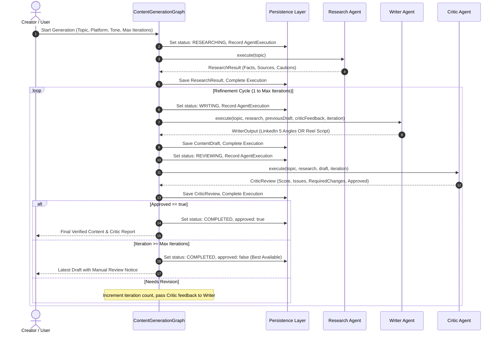

# ContentForge Multi-Agent Workflow

## Overview

ContentForge replaces trial-and-error prompting with a deterministic 3-agent orchestration pipeline.

---

## Agent Responsibilities

### 1. Research Agent
- **System Prompt**: *"You are a research specialist. Your job is to gather reliable information for another AI system. Do not write social media content. Do not fabricate sources. Clearly distinguish verified facts from uncertain information."*
- **Inputs**: User topic.
- **Tools**: `ResearchProvider` (Web Search).
- **Outputs**:
  - `summary`: Factual overview.
  - `keyPoints`: 3–5 high-signal takeaways.
  - `facts`: Specific factual assertions mapped to sources with confidence ratings (`high`, `medium`, `low`).
  - `sources`: Authoritative title, publisher, and valid URL.
  - `cautions`: Data limitations and disputed claims.

### 2. Writer Agent
- **System Prompt**: *"You are a professional content writer. Use the supplied research as your factual foundation. Do not invent statistics or sources. Adapt the content to the specified platform, audience, and tone. When revising, directly address the critic's feedback."*
- **Platform Behaviors**:
  - **LinkedIn**: Generates 4–5 distinct angle posts (`Educational`, `Contrarian/question-driven`, `Storytelling`, `Practical/step-by-step`, `Data/insight driven`). Each contains a scroll-stopping hook, structured body, and tailored CTA.
  - **Instagram Reel**: Generates a scene-by-scene short-form video script with timestamps (e.g. `0–5 sec`), camera & visual cues, voiceover script, and on-screen text overlays.
- **Revisions**: In iterations > 1, the Writer receives the exact issues and required changes flagged by the Critic Agent.

### 3. Critic & Quality Agent
- **System Prompt**: *"You are a rigorous content quality reviewer. Evaluate factual support, clarity, platform fit, originality, structure, and unsupported claims. Do not approve content merely because it sounds convincing. Identify concrete problems and provide actionable revision instructions."*
- **Evaluation Criteria**:
  - Factual Accuracy & Research Grounding
  - Platform Fit & Structural Compliance
  - Hook Quality & Scroll-Stopping Power
  - Clarity & Absence of Generic AI Clichés
- **Approval Logic**:
  - High severity issues immediately force `approved: false`.
  - Content with factual accuracy < 80% is rejected and returned to the Writer with specific instructions.
  - When rejected, explicit numbered instructions are written into `requiredChanges`.

---

## Best-Available Fallback
When maximum review iterations (configurable 1–5) are reached without meeting strict approval criteria:
- The system returns the latest draft.
- It explicitly marks `approved = false`.
- The UI renders a prominent warning: *"Maximum review iterations reached. This content is the latest draft and may need manual review."*
- Content is never deceptively labeled as fully verified if rejected by the Critic.
