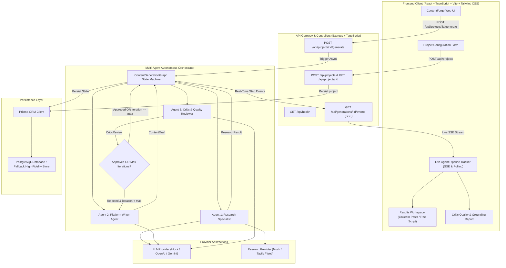

# ContentForge Architecture

## 1. Executive Summary

ContentForge is a production-quality, autonomous multi-agent content generation platform. The system operates on the central product tenet:

> **"Don't make the user repeatedly prompt the AI. Let the AI research, write, critique, and refine itself."**

Instead of single-turn prompting where the human creator must act as the researcher, fact-checker, and editor, ContentForge employs a specialized multi-agent graph with autonomous self-refinement loops.

---

## 2. System Architecture Diagram

---

## 3. Tech Stack

### Frontend
- **Framework**: React 19, TypeScript
- **Build Tool**: Vite
- **Styling**: Tailwind CSS
- **Routing**: React Router 7
- **Data Fetching & Caching**: TanStack Query (React Query v5)
- **Icons**: Lucide React + Custom Platform SVGs

### Backend
- **Runtime**: Node.js v24, TypeScript
- **Framework**: Express.js
- **Architecture**: Modular layered architecture (Controllers -> Services -> Agents -> Providers -> Database)
- **Validation**: Zod (100% strict validation on API inputs, agent outputs, and database objects)
- **Real-Time Streaming**: Server-Sent Events (SSE) with resilient polling fallback

### AI & Agent Layer
- **Orchestration**: Graph State Machine (`ContentGenerationGraph`) supporting states, nodes, conditional edges, structured outputs, and iteration loops.
- **Provider Abstraction**:
  - `LLMProvider`: Generates structured typed outputs validated via Zod schemas.
  - `ResearchProvider`: Gathers external search citations and snippets.

### Database
- **ORM**: Prisma ORM
- **Database**: PostgreSQL with schema models for `User`, `ContentProject`, `ContentGeneration`, `ResearchResult`, `ContentDraft`, `CriticReview`, and `AgentExecution`.
- **High-Fidelity Store**: Built-in persistence adapter allowing zero-dependency local operation when external PostgreSQL connection is offline.

---

## 4. Security & Cost Guardrails
1. **No API Keys in Frontend**: Secrets reside strictly in backend environment variables.
2. **Deterministic Max Iteration Bounds**: Hard limit of 1–5 iterations (default: 3) prevents runaway token usage or infinite loops.
3. **Research-Once Optimization**: Web research is executed once at the start of generation and shared across all refinement cycles, eliminating redundant API costs.
4. **Programmatic Quality Enforcement**: High-severity issues detected by the Critic Agent programmatically invalidate approval regardless of raw model confidence.
